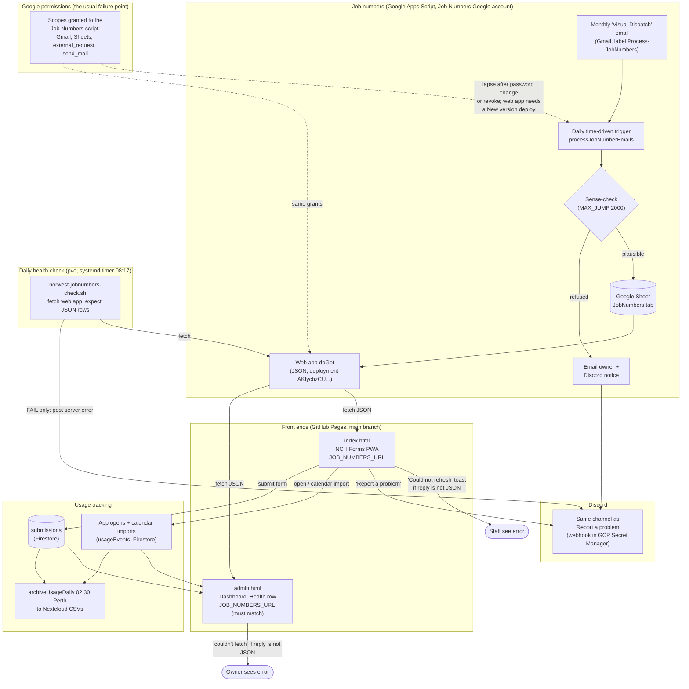

# NCH Forms — how the whole system fits together

Overview of every moving part, what depends on what, and what breaks when. Start here, then
read `job-numbers-handover.md` for the Apps Script detail and `RUNBOOK.md` for deploys.

## Flowchart

## Where the job-numbers URL lives

There is one live web-app URL. It is written into **two** files and both must match:

| File | Constant | Used by |
|---|---|---|
| `index.html` | `JOB_NUMBERS_URL` (line ~910) | PWA: refresh, autofill, "New job numbers" |
| `admin.html` | `JOB_NUMBERS_URL` (line ~239) | Admin dashboard Health row |

The URL changes when the web app gets a **new deployment**, not on a normal new version.
After any new deployment, update both constants and bump the service worker cache name.

## What to check when something breaks

| Symptom | Where you see it | Cause seen so far | Fix |
|---|---|---|---|
| PWA: "Could not refresh — check connection" | PWA job numbers card | Web app returns an Apps Script error page (permission error). Not the phone's connection. | Run `testSetup` in the Job Numbers script editor, tick Select all, Allow. Then Deploy → Manage deployments → New version → Deploy. Check the URL returns a JSON list. |
| Admin Health: "couldn't fetch" | Admin dashboard | `admin.html` still had a dead deployment URL. Fixed 12 Nov (commit 2185504). | Make `admin.html` use the same URL as `index.html`. |
| No new job numbers after the monthly email | Trigger history in the script editor | Gmail grant lapsed (4–5 Nov, after a password change). | Same as above: re-run `testSetup` with Select all. |
| Scopes "suddenly" missing after a manifest edit | Trigger and web app both fail | `oauthScopes` in `appsscript.json` REPLACES auto-detected scopes. Keep the full explicit list. (29 Oct.) | Restore the full scope list, then re-consent. |
| A number is missing from the sheet | Email to owner + Discord notice | Sense-check refused a number far from recent months. Deliberate. | Use `traceValue` in the script to find the source email. |
| Daily check posts to Discord | Discord, same channel as "Report a problem" | The web app stopped returning JSON. The message includes the server's error. | Use the fix in the first row. |

## Monitoring

- **Daily check**, `norwest-jobnumbers-check.timer` on pve, 08:17 each morning. Silent when healthy;
  posts to Discord when the web app isn't returning JSON. Script:
  `tools/jobnumbers-check.sh` (also installed at `/usr/local/sbin/norwest-jobnumbers-check.sh` on pve).
- **Reaper history**: the script editor's trigger page, or the Apps Script API `/v1/processes` (owner-side).

## Not in this file

Webhook URLs, OAuth client secrets and refresh tokens are not written here. They live in GCP
Secret Manager (`DISCORD_WEBHOOK_URL`) and the homelab secrets file.
