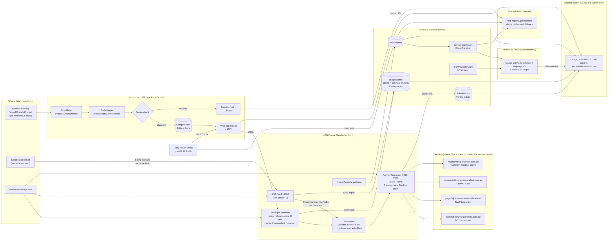
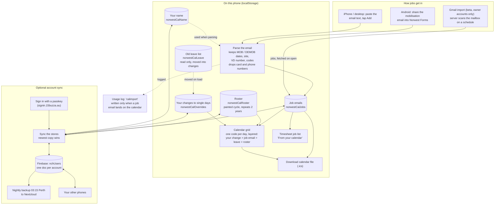

# NCH Forms — how everything is connected

Where each piece of data comes from, where it goes, and which service holds it. Read this with
`PROJECT_CONTEXT.md` (app detail), `job-numbers-handover.md` (Apps Script) and `RUNBOOK.md` (deploys and fixes).

## 1. Whole system

## 2. The job calendar in detail

The calendar lives on each phone. Optional sign-in syncs it to the owner's other phones.

What the calendar does for the worker:

- **Jobs from the mobilisation email** show on the grid and in the timesheet's "From your calendar" group.
  Picking one there fills in the job for that day, with the VD number.
- **Roster**: paint one cycle (for example 21 DS then 7 RNR) once; it repeats for two years.
- **Changes to single days** always win over the email and the roster.
- **Download .ics** exports the grid to a normal calendar app.
- **Sync** (optional): the five stores and the profile sync to the account. Clearing the browser data
  loses the local copy unless the account is signed in.
- **Gmail import** is in beta and only for two owner accounts. It is separate from the share/paste route.

## 3. Where each form goes

| Form | Who it's for | Sent to | Notes |
|---|---|---|---|
| NCH weekly timesheet | Norwest Crane Hire | `admin@norwestcranehire.com.au` | Job lines can use calendar jobs or the auto-filled sheet number. |
| NWP weekly timesheet | Norwest Personnel | `payroll@norwestpersonnel.com.au` | |
| Leave / R&R | Both companies | `opsadmin@norwestcranehire.com.au` | Hard-coded in `submitLeave()`. Leave is not written to the calendar by the current app. |
| Training payment claim | Norwest Personnel | `hr@norwestpersonnel.com.au` | Sent via `submitClaimPdf()`. |
| Medical & D&A allowance claim | Norwest Personnel | `hr@norwestpersonnel.com.au` | Same route as the training claim. |

The app never emails anything itself. Sending uses the phone's **Share** sheet when available, otherwise it
copies the address and opens a `mailto:` link. The worker presses send.

## 4. Where the job numbers come from

1. Norwest's monthly **Visual Dispatch** email carries the job numbers for the five sites.
2. A Gmail label marks it; the daily trigger writes it to the **JobNumbers** sheet.
3. The web app serves the sheet as JSON.
4. **Each phone** fetches it (on open, refresh, and every 30 min while this month is missing) and stores it locally.
   Picking a client on a timesheet line fills in that month's number.
5. The **admin dashboard** reads the same JSON for its Health row.

Job numbers from the sheet and jobs from the calendar both feed the timesheet job line. They are separate sources.

## 5. What is logged

- **Every send** writes a row to `submissions` (form, name, company, installed or browser, IP, time).
- **Every app open** and **calendar import** writes a row to `usageEvents`.
- **Help reports** go to `helpReports`; a Cloud Function forwards them to Nextcloud and Discord.
- Firestore rows expire after 90 days. `archiveUsageDaily` (02:30 Perth) keeps monthly CSVs in Nextcloud forever.

## 6. Where things live

| Thing | Where | Deployed by |
|---|---|---|
| `index.html`, `admin.html`, `service-worker.js` | GitHub Pages (`main`) | Push to `main` |
| Job numbers script and sheet | Google Apps Script (job numbers Google account) | Editor: Deploy → Manage deployments |
| Firestore rules, Cloud Functions | Firebase `norwest-forms` | From pve: `firebase deploy` |
| Calendar sync data | Firestore `nchUsers` (one doc per account) | Cloud Functions `nchCalendarGet` / `nchCalendarPut` |
| Gmail import data (beta) | Firestore `nchGmail` | Cloud Functions `nchGmail*` |
| Daily health check | pve systemd timer, 08:17 Perth | `tools/jobnumbers-check.sh` |
| Discord webhook | GCP Secret Manager `DISCORD_WEBHOOK_URL` | Never in code |

## 7. The job-numbers URL is in two files

`index.html` and `admin.html` each have a `JOB_NUMBERS_URL` constant, and they must match. The URL only changes
with a **new deployment** of the web app (not a new version). After one, update both files and bump the service
worker cache name.

## 8. What to check when something breaks

| Symptom | Where you see it | Cause seen so far | Fix |
|---|---|---|---|
| PWA: "Could not refresh — check connection" | Job numbers card | Web app returns an Apps Script permission error. Not the phone's connection. | Run `testSetup` in the script editor with Select all. Then Deploy → Manage deployments → New version. Check the URL returns JSON. |
| Admin Health: "couldn't fetch" | Admin dashboard | `admin.html` pointed at a dead URL. Fixed 12 Nov (commit `2185504`). | Keep the URL the same as `index.html`. |
| No new job numbers after the monthly email | Trigger history in the script editor | Gmail permission lapsed (4–5 Nov, after a password change). | Same as the first row. |
| Permissions suddenly missing after a manifest edit | Trigger and web app both fail | `oauthScopes` replaces auto-detected scopes. Keep the full list. (29 Oct.) | Restore the full scope list, then re-consent. |
| A job number is missing from the sheet | Owner email + Discord notice | Sense-check refused a number far from recent months. Deliberate. | Use `traceValue` in the script to find the source email. |
| Daily check posts to Discord | Discord channel | The web app stopped returning JSON. The message has the server's error. | Use the first row's fix. |

## 9. Not in this file

Webhook URLs, OAuth client secrets and refresh tokens are not written here. They live in GCP Secret Manager
and the homelab secrets file.
