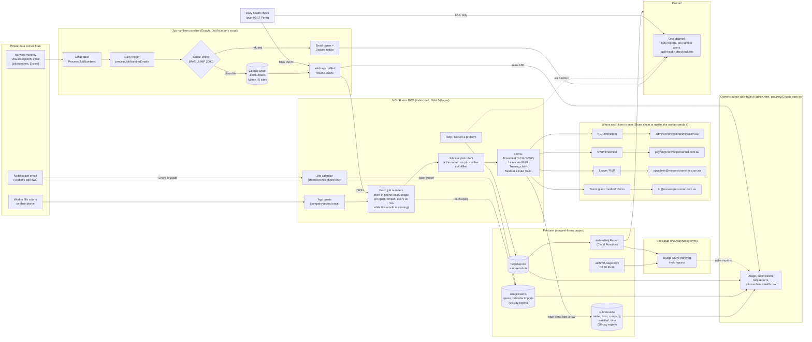

# NCH Forms — how everything is connected

Where each piece of data comes from, where it goes, and which Google/Firebase/GitHub service
holds it. Read this with `PROJECT_CONTEXT.md` (app detail), `job-numbers-handover.md` (Apps Script)
and `RUNBOOK.md` (deploys and fixes).

## 1. Full picture

## 2. Where each form goes

| Form | Who it's for | Sent to | Notes |
|---|---|---|---|
| NCH weekly timesheet | Norwest Crane Hire | `admin@norwestcranehire.com.au` | Job lines use auto-filled job numbers. |
| NWP weekly timesheet | Norwest Personnel | `payroll@norwestpersonnel.com.au` | |
| Leave / R&R | Both companies | `opsadmin@norwestcranehire.com.au` | Address hard-coded in `submitLeave()` for both companies. |
| Training payment claim | Norwest Personnel | `hr@norwestpersonnel.com.au` | Sent via `submitClaimPdf()`, not the company admin address. |
| Medical & D&A allowance claim | Norwest Personnel | `hr@norwestpersonnel.com.au` | Same path as training claim. |

Sending uses the phone's **Share** sheet when available (the PDF is attached). Otherwise it copies the
address and opens a `mailto:` link. Either way the worker sends it; the app doesn't email anything itself.

## 3. Where the job numbers come from

1. Norwest's monthly **Visual Dispatch** email carries the job numbers for the 5 sites.
2. A Gmail label (`Process-JobNumbers`) marks it; the daily trigger reads it into the **JobNumbers** sheet.
3. The sheet is served as JSON by the web app (`doGet`).
4. **Each phone** fetches it itself (on open, refresh, and every 30 min while the current month is missing) and
   stores it locally. Picking a client on a timesheet job line fills in that month's number.
5. The **admin dashboard** reads the same JSON for its Health row.

The **mobilisation email** is different: it lists one worker's job rows. Sharing it into the app adds them to
the **job calendar** on that phone only. I found no code that feeds the calendar into the timesheet.

## 4. What is logged

- **Every send** writes a row to `submissions` (form, name, company, installed or browser, IP, time).
- **Every app open** and **calendar import** writes a row to `usageEvents`.
- **Help reports** go to `helpReports`, then a Cloud Function forwards them to Nextcloud and Discord.
- Firestore rows expire after 90 days. `archiveUsageDaily` (02:30 Perth) keeps monthly CSVs in Nextcloud
  forever, and the admin dashboard reads them back for older months.

## 5. Where things live

| Thing | Where | Deployed by |
|---|---|---|
| `index.html`, `admin.html`, `service-worker.js` | GitHub Pages (`main`) | Push to `main` |
| Job numbers script and sheet | Google Apps Script (job numbers Google account) | Editor: Deploy → Manage deployments |
| Firestore rules, Cloud Functions | Firebase `norwest-forms` | From pve: `firebase deploy` |
| Daily health check | pve systemd timer, 08:17 | `tools/jobnumbers-check.sh` |
| Discord webhook | GCP Secret Manager `DISCORD_WEBHOOK_URL` | Never in code |

## 6. The job-numbers URL is in two files

`index.html` and `admin.html` each have a `JOB_NUMBERS_URL` constant. They must match. The URL only
changes when the web app gets a **new deployment** (not a new version). After one, update both files and bump
the service worker cache name.

## 7. What to check when something breaks

| Symptom | Where you see it | Cause seen so far | Fix |
|---|---|---|---|
| PWA: "Could not refresh — check connection" | Job numbers card | Web app returns an Apps Script permission error. Not the phone's connection. | Run `testSetup` in the script editor with Select all. Then Deploy → Manage deployments → New version. Check the URL returns JSON. |
| Admin Health: "couldn't fetch" | Admin dashboard | `admin.html` pointed at a dead URL. Fixed 12 Nov (commit `2185504`). | Keep the URL the same as `index.html`. |
| No new job numbers after the monthly email | Trigger history in the script editor | Gmail permission lapsed (4–5 Nov, after a password change). | Same as the first row: run `testSetup` with Select all. |
| Permissions suddenly missing after a manifest edit | Trigger and web app both fail | `oauthScopes` replaces auto-detected scopes. Keep the full list. (29 Oct.) | Restore the full scope list, then re-consent. |
| A job number is missing from the sheet | Email to owner + Discord notice | Sense-check refused a number far from recent months. Deliberate. | Use `traceValue` in the script to find the source email. |
| Daily check posts to Discord | Discord channel | The web app stopped returning JSON. The message has the server's error. | Use the first row's fix. |

## 8. Not in this file

Webhook URLs, OAuth client secrets and refresh tokens are not written here. They live in GCP Secret Manager
(`DISCORD_WEBHOOK_URL`) and the homelab secrets file.
